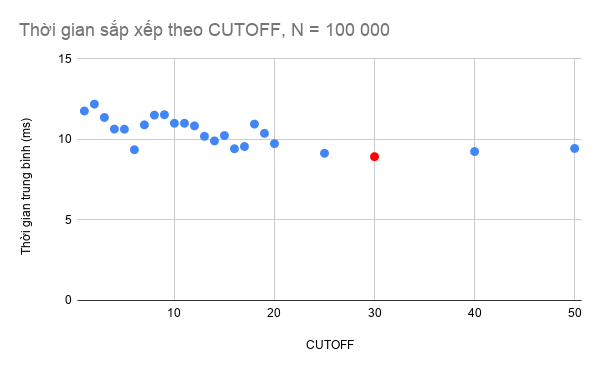
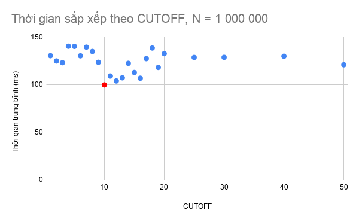

# Thí nghiệm tìm CUTOFF tối ưu cho Mergesort

## 1. Mục tiêu
Tìm giá trị CUTOFF tối ưu cho thuật toán mergesort trên một máy cụ thể, khi CUTOFF là ngưỡng để chuyển từ mergesort sang insertion sort cho các đoạn mảng nhỏ. So sánh kết quả với hai mốc 7 và 10 trong giáo trình.
## 2. Môi trường thí nghiệm
- Hệ điều hành: Windows (phiên bản: ghi theo Settings > System > About)
- CPU: Intel Core i5-13420H, 8 nhân, 12 luồng logic, tốc độ cơ sở 2.10 GHz
- Cache: L1 704 KB, L2 7.0 MB, L3 12.0 MB
- RAM: 15.6 GB
- Java: OpenJDK 26.0.1 (JDK)
- IDE: IntelliJ IDEA Community
- Điều kiện khi đo: cắm sạc, đóng các ứng dụng khác, không thao tác trên máy trong lúc chạy

## 3. Cài đặt
Mergesort được cài đặt bằng Java theo nội dung : chia đôi mảng, sắp xếp đệ quy hai nửa, trộn bằng mảng phụ aux. Khi đoạn có không quá CUTOFF phần tử, thuật toán dùng insertion sort. Mã nguồn nằm trong src/MergeSort.java.

## 4. Kiểm tra đúng đắn
Trước khi đo thời gian, thuật toán được kiểm tra bằng src/TestMergeSort.java với 16 giá trị CUTOFF. Mỗi CUTOFF được thử trên mảng rỗng, mảng biên, mảng có nhiều số trùng, 1 430 mảng ngẫu nhiên và hai mảng 10 000 phần tử (đã sắp xếp, sắp ngược). Kết quả: 22 880 trường hợp, 0 trường hợp sai.

## 5. Phương pháp thí nghiệm
## 5. Phương pháp thí nghiệm

### 5.1. Biến

| Loại | Nội dung |
|---|---|
| Biến độc lập | CUTOFF, gồm 24 giá trị: 1 đến 20, rồi 25, 30, 40, 50 |
| Biến phụ thuộc | Thời gian sắp xếp (mili-giây), đo bằng `System.nanoTime()` |
| Tham số cố định | Cỡ mảng N ∈ {10 000, 100 000, 1 000 000}; 10 trial cho mỗi N |

### 5.2. Dữ liệu

Dữ liệu thí nghiệm gồm 30 file trong thư mục `data/`, sinh bởi `src/DataGenerator.java`:
- Mỗi file là một dãy số nguyên ngẫu nhiên trong khoảng [0, 10⁹), mỗi số một dòng.
- Với mỗi cỡ N có 10 file, tương ứng 10 trial (`trial0` đến `trial9`).
- Mỗi file dùng seed bằng số thứ tự của trial (`new Random(t)`), nên dữ liệu có thể tái tạo chính xác.

### 5.3. Quy trình đo

Chương trình `src/Experiment.java` thực hiện như sau:

1. **Khởi động (warm-up):** sắp xếp 5 lần một mảng 100 000 phần tử để máy ảo Java (JVM) được tối ưu trước khi đo. Các lần này không được ghi lại.
2. **Lặp theo trial:** với mỗi N và mỗi trial `t`, đọc file dữ liệu tương ứng một lần.
3. **Lặp theo CUTOFF:** với mỗi CUTOFF, copy mảng để không dùng lại mảng đã được sắp xếp, rồi đo thời gian của lời gọi `MergeSort.sort`. Chỉ phần sắp xếp được tính, không tính đọc file và copy.
4. **Kiểm tra kết quả:** sau mỗi lần sắp xếp, chương trình kiểm tra mảng có tăng dần không. Nếu sai, chương trình dừng với thông báo lỗi. Trong thí nghiệm không có lỗi nào.
5. **Ghi kết quả:** mỗi phép đo là một dòng trong `results/raw.csv`, gồm CUTOFF, N, trial và thời gian (ms). Tổng cộng 720 dòng dữ liệu.

Thứ tự vòng lặp (trial ngoài, CUTOFF trong) có một ý nghĩa: với cùng một trial, mọi CUTOFF được đo trong cùng một khoảng thời gian ngắn, nên điều kiện máy gần như giống nhau khi so sánh các CUTOFF.

### 5.4. Môi trường và cách chạy

- Máy, Java và IDE như mục 2.
- Chương trình chạy trong IntelliJ IDEA, mỗi lần chạy toàn bộ thí nghiệm một lần.
- Trong lúc đo, máy cắm sạc và không có thao tác nào của người dùng. Điều kiện khác (trình duyệt đang mở, RAM ở mức cao) được nêu ở mục 8.

### 5.5. Tổng hợp số liệu

Với mỗi cặp (CUTOFF, N), có 10 giá trị thời gian. Các thống kê được tính trên 10 giá trị này bằng Google Sheets (PivotTable):
- **Trung vị (median):** là chỉ số chính dùng để so sánh các CUTOFF, vì ít bị ảnh hưởng bởi vài lần chậm đột biến.
- **Trung bình (mean)** và **giá trị nhỏ nhất (min)**: dùng để kiểm tra chéo.
- **Độ lệch chuẩn (stdev):** dùng để đánh giá mức dao động của phép đo.

## 6. Kết quả
## 6. Kết quả

### 6.1. Thời gian trung vị theo CUTOFF

Bảng dưới trình bày một số CUTOFF tiêu biểu. Bảng đầy đủ 24 giá trị nằm trong phụ lục.

| CUTOFF | N = 10 000 (ms) | N = 100 000 (ms) | N = 1 000 000 (ms) |
|---|---|---|---|
| 1 | 0.702 | 11.056 | 125.232 |
| 3 | 0.611 | 8.686 | 119.959 |
| 7 | 0.624 | 9.107 | 133.736 |
| 10 | 0.624 | 9.118 | 91.045 |
| 14 | 0.544 | 8.757 | 115.595 |
| 16 | 0.553 | 6.856 | 93.795 |
| 20 | 0.531 | 6.859 | 118.536 |
| 25 | 0.557 | 6.465 | 133.630 |
| 30 | 0.528 | 7.666 | 121.687 |

### 6.2. CUTOFF có thời gian trung vị thấp nhất

| N | CUTOFF tốt nhất | Trung vị tốt nhất (ms) | Trung vị của CUTOFF 7 (ms) | CUTOFF 7 chậm hơn |
|---|---|---|---|---|
| 10 000 | 30 | 0.528 | 0.624 | khoảng 18% |
| 100 000 | 25 | 6.465 | 9.107 | khoảng 41% |
| 1 000 000 | 10 | 91.045 | 133.736 | khoảng 47% |

Ở N = 10 000, CUTOFF 7 và CUTOFF 10 có trung vị gần như bằng nhau (0.624 ms và 0.624 ms).

### 6.3. Độ lệch chuẩn

Độ lệch chuẩn của CUTOFF 7 và 10 (tính trên 10 trial):

| N | CUTOFF 7 (ms) | CUTOFF 10 (ms) |
|---|---|---|
| 10 000 | 0.115 | 0.103 |
| 100 000 | 4.442 | 4.880 |
| 1 000 000 | 27.035 | 25.135 |

Độ lệch chuẩn của N = 10 000 lớn hơn chênh lệch trung vị giữa CUTOFF 7 và 10. Với N = 100 000 và 1 000 000, độ lệch chuẩn lớn so với khoảng cách giữa các trung vị gần nhau.

### 6.4. Kiểm tra chéo bằng trung bình và giá trị nhỏ nhất

| N | CUTOFF tốt nhất theo trung bình | CUTOFF tốt nhất theo giá trị nhỏ nhất |
|---|---|---|
| 10 000 | 30 | 20 |
| 100 000 | 30 | 30 |
| 1 000 000 | 10 | 17 |

### 6.5. Biểu đồ

 bình theo CUTOFF, N = 10 000](chart_n10000.png)

Các điểm đỏ là CUTOFF có thời gian trung bình thấp nhất trong từng cỡ N.
### 6.6. Bằng chứng

- Bảng tính đầy đủ (Google Sheets, chỉ xem): [https://docs.google.com/spreadsheets/d/154AeXQNk-Ot4qPXXeRaWKJLEhS9W1uxZRg5d_f2iwgY/edit?usp=sharing]
- Bản sao dự phòng: `results/phan-tich-cutoff.xlsx`
- Dữ liệu đo gốc: `results/raw.csv`
- Kết quả kiểm tra đúng đắn: `report/test_result.png`
## 7. Phân tích

### 7.1. Hai chi phí đối nghịch

Mergesort với CUTOFF = M chia mảng thành các đoạn cỡ khoảng M rồi dùng insertion sort cho từng đoạn.

- **Chi phí của mergesort (chia và trộn):** số lần gọi đệ quy tỉ lệ với N/M. Khi M nhỏ, có rất nhiều lời gọi hàm cho những đoạn quá ngắn, nên overhead lớn.
- **Chi phí của insertion sort:** với một đoạn cỡ M ngẫu nhiên, insertion sort cần khoảng M²/4 phép so sánh. Có khoảng N/M đoạn, nên tổng chi phí khoảng N·M/4, tăng tuyến tính theo M.

Tổng chi phí xấp xỉ có dạng a·N/M + b·N·M. Hàm này đạt cực tiểu khi M ≈ √(a/b), tức là điểm cân bằng giữa hai chi phí. Mô hình này chỉ cho biết **xu hướng**: CUTOFF tối ưu là một giá trị vừa phải, không quá nhỏ và không quá lớn. Giá trị cụ thể phụ thuộc hằng số a và b, tức là phụ thuộc vào máy và Java.

### 7.2. Kết quả khớp với mô hình

- **N = 10 000:** thời gian giảm mạnh từ CUTOFF 1 đến khoảng 10, sau đó gần như phẳng từ 10 đến 30. Từ CUTOFF 40 đến 50, thời gian không tăng rõ, có thể do số liệu nằm trong vùng nhiễu.
- **N = 100 000:** dạng tương tự, vùng thấp nằm khoảng 16 đến 30.
- **N = 1 000 000:** đường cong dao động mạnh. Vùng thấp nhất khoảng 10 đến 17, nhưng dao động lớn giữa các CUTOFF lân cận.

### 7.3. Vì sao CUTOFF 7 không phải tối ưu trên máy này

Với N = 10⁴ và 10⁵, CUTOFF 7 chậm hơn vùng 20 đến 30 khoảng 18% đến 41% theo trung vị. Với N = 10⁶, chênh lệch đạt khoảng 47%. Mốc 7 của sách cũ được đo trên máy và phiên bản Java khác. Trên máy này, chi phí của insertion sort và chi phí gọi hàm có tỉ lệ khác, nên điểm cân bằng dịch sang phải. Điều này phù hợp với mô hình ở mục 7.1.

### 7.4. Vì sao không chọn một giá trị duy nhất

Trong vùng từ 10 đến 30, ở N = 10⁴ trung vị dao động từ 0.53 ms đến 0.62 ms, còn độ lệch chuẩn khoảng 0.07 đến 0.12 ms. Chênh lệch giữa các CUTOFF gần nhau nằm trong mức nhiễu của phép đo. Vì vậy, nói "CUTOFF 30 tốt nhất" là vượt quá những gì dữ liệu chứng minh được. Cách trung thực là nói vùng 20 đến 30 cho thời gian thấp, còn giá trị cụ thể thì không phân biệt được.

### 7.5. Điểm chưa giải thích chắc chắn

Ở N = 10⁶, CUTOFF 9 có trung vị khoảng 122 ms, còn CUTOFF 10 chỉ khoảng 91 ms. Một bước nhảy như vậy không khớp với mô hình mượt ở mục 7.1. Các nguyên nhân có thể là nhiễu của máy (đã nêu ở mục 8), hoặc ảnh hưởng của bộ nhớ đệm và cách JVM tối ưu mã trong lúc chạy. Bài này không kiểm chứng được nguyên nhân cụ thể, nên chỉ nêu là có thể.

## 8. Hạn chế

- **Một máy duy nhất.** Kết quả phản ánh cấu hình Intel Core i5-13420H và Java 26.0.1. Máy khác có thể cho vùng CUTOFF khác.
- **Điều kiện đo chưa lý tưởng.** Trong lúc đo, trình duyệt với nhiều tab đang mở và RAM ở mức khoảng 88%. Điều này làm tăng độ dao động, đặc biệt ở N = 10⁶.
- **Chạy trong IDE.** Chương trình chạy trong IntelliJ IDEA, không phải từ dòng lệnh, nên có thể có thêm tác vụ nền.
- **Chỉ một loại dữ liệu.** Thí nghiệm chỉ dùng mảng số ngẫu nhiên. Với mảng đã sắp xếp hoặc có nhiều số trùng, kết quả có thể khác.
- **Số lần lặp vừa phải.** Mỗi cặp (CUTOFF, N) chỉ có 10 lần đo. Nhiều lần hơn sẽ làm ước lượng trung vị ổn định hơn.
- **Đo thời gian trong JVM.** Java có JIT và bộ dọn rác, làm thời gian mỗi lần đo có thể khác nhau ngoài ý muốn. Warm-up giảm ảnh hưởng này nhưng không loại bỏ hoàn toàn.

Các hạn chế trên không làm mất giá trị của thí nghiệm, nhưng yêu cầu kết luận phải được diễn đạt thận trọng, như ở mục 9.

## 9. Kết luận

Trên máy thí nghiệm của tôi (Intel Core i5-13420H, Java 26.0.1, Windows), mergesort đạt thời gian thấp nhất khi CUTOFF nằm trong khoảng 20 đến 30 với N = 10 000 và 100 000. Với N = 1 000 000, vùng thấp nhất nằm trong khoảng 10 đến 17. Trong các vùng này, chênh lệch giữa các CUTOFF nhỏ hơn độ dao động của phép đo, nên không xác định được một giá trị tối ưu duy nhất.

CUTOFF 7 của giáo trình cũ chậm hơn vùng tối ưu trên máy này, từ khoảng 18% đến 47% tùy cỡ mảng. Điều này cho thấy giá trị CUTOFF tốt nhất phụ thuộc vào máy và môi trường chạy, và nên được đo lại trên từng máy cụ thể trước khi áp dụng.

## 10. Ghi chú về việc sử dụng AI

Trong quá trình làm bài, em đã sử dụng một trợ lý AI (Claude) để:
- Giải thích các khái niệm: CUTOFF, đệ quy, ý nghĩa của seed, nhiễu trong đo thời gian.
- Gợi ý cấu trúc code và viết các script `DataGenerator`, `Experiment`, `TestMergeSort`.
- Hướng dẫn cách dùng Google Sheets để tổng hợp số liệu.
- Hỗ trợ viết khung báo cáo.

Em tự quyết định các phần sau: 
- Chọn tập giá trị CUTOFF
- Chọn trung vị làm thống kê chính
- Đối chiếu kết quả với bảng tính 
- Viết phần phân tích và kết luận
- Em đã đọc, chạy và kiểm tra từng phần code